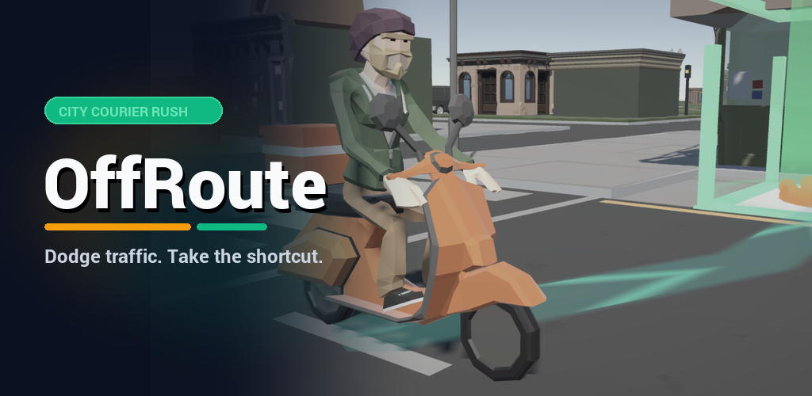
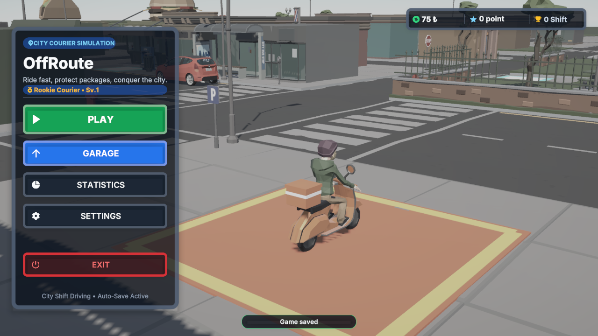
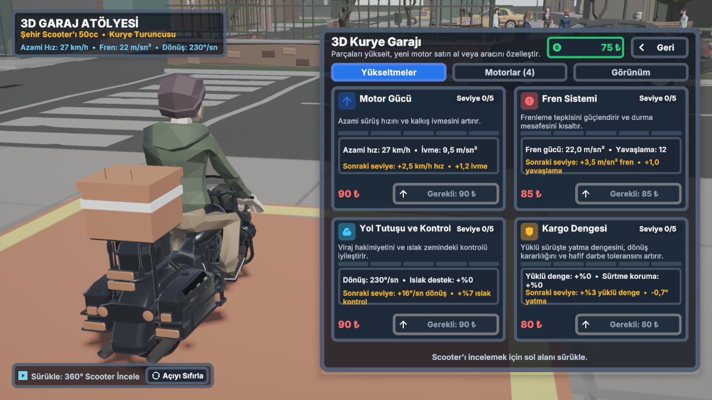
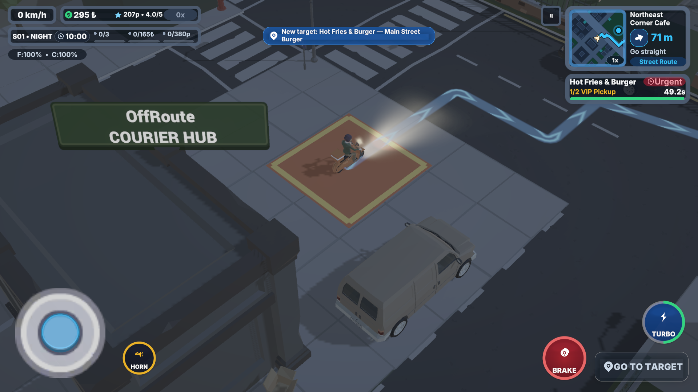
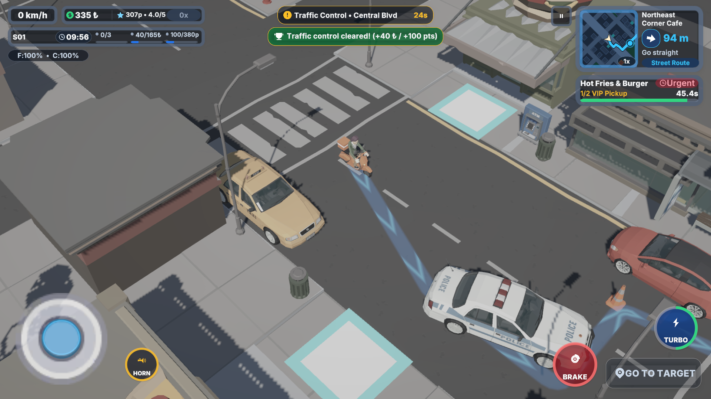

# 🛵 OffRoute — City Courier & Delivery Simulation

**OffRoute** is an Android-focused urban courier and delivery simulation built with Unity. Ride your scooter through busy city traffic, deliver orders on time, handle dynamic road events, and grow your earnings based on shift performance.

---

## ✨ Key Features

- 🛵 **Arcade Scooter Handling:** Responsive mobile joystick, brake, turbo boost, and horn controls
- 🗺️ **Smart Street Navigation:** A* pathfinding across the street network with a live minimap and 3D target beacons
- 📦 **Orders & Economy System:** Timed deliveries, combo multipliers, shift grading, upgrades, and unlockable bikes/cosmetics
- 🚦 **Living City & Dynamic Events:** Traffic, pedestrians, day/sunset/night cycles, roadworks, rain, and police checkpoints
- 🌍 **Multi-Language Support:** Full English (EN) and Turkish (TR) localization with automatic device language detection
- 📳 **Mobile Polish:** Android haptic feedback and touch-friendly HUD scaling

---

## 📸 Screenshots

| Main Menu | 3D Garage & Upgrades |
| :---: | :---: |
|  |  |

| Day Delivery | Night Shift | Traffic Control |
| :---: | :---: | :---: |
|  |  |  |

---

## 🎮 Controls

| Action | 📱 Mobile Control |
| :--- | :--- |
| **Ride & Steer** | On-Screen Virtual Joystick |
| **Brake** | `BRAKE` Button |
| **Pick Up / Deliver** | Delivery Action Button |
| **Turbo Boost** | Turbo Button |
| **Horn** | Horn Button |

---

## 📲 Download & Try

- 🔗 **Google Play Store:** *(Coming Soon)*
