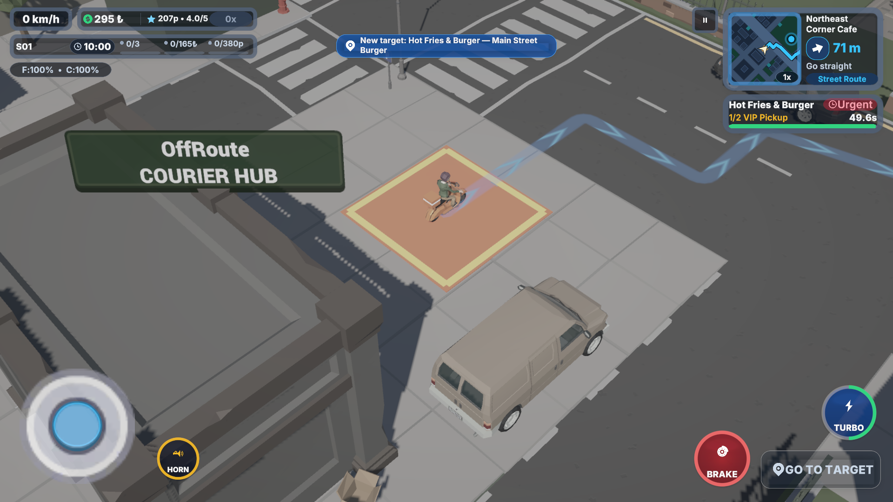

# 🛵 OffRoute (ROTA DIŞI) — Courier & Delivery Simulation

**OffRoute (ROTA DIŞI)**, Unity ile geliştirilen Android odaklı bir şehir içi kurye ve teslimat simülasyonudur. Oyuncular scooter ile yoğun şehir trafiğinde siparişleri zamanında teslim eder, dinamik yol olaylarıyla başa çıkar ve vardiya performansına göre kazanç elde eder.

---

## ✨ Öne Çıkan Özellikler

- 🛵 **Gerçekçi Scooter Sürüşü:** Mobil joystick, fren, turbo ve korna kontrolleri
- 🗺️ **Akıllı Navigasyon:** Sokak ağı üzerinde A* yol bulma, mini harita ve 3D hedef işaretçileri
- 📦 **Sipariş & Ekonomi Sistemi:** Teslimat süreleri, combo çarpanları, vardiya puanlaması ve scooter yükseltmeleri
- 🚦 **Dinamik Şehir:** Akan trafik, yayalar, gece-gündüz döngüsü ve yol çalışması olayları
- 🌍 **Çoklu Dil Desteği:** Cihaz dilini otomatik algılayan Türkçe (TR) ve İngilizce (EN) lokalizasyon
- 📳 **Mobil Deneyim:** Android titreşim (haptic feedback) ve dokunmatik arayüz optimizasyonu

---

## 📸 Ekran Görüntüleri

| Ana Menü | Garaj & Yükseltmeler |
| :---: | :---: |
|  |  |

| Gündüz Teslimatı | Gece Vardiyası | Polis Kontrol Noktası |
| :---: | :---: | :---: |
|  |  |  |

---

## 🎮 Kontroller

| Eylem | 📱 Mobil Kontrol |
| :--- | :--- |
| **Sürüş** | Ekran Joystick'i |
| **Fren** | `FREN` Düğmesi |
| **Teslim Et** | Teslimat Düğmesi |
| **Turbo** | Turbo Düğmesi |
| **Korna** | Korna Düğmesi |

---

## 📲 İndir & Dene

- 🔗 **Google Play Store:** *(Yakında / Link buraya)*
